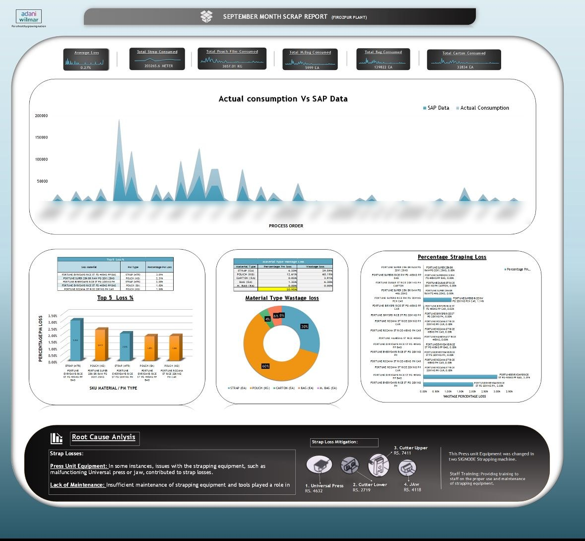
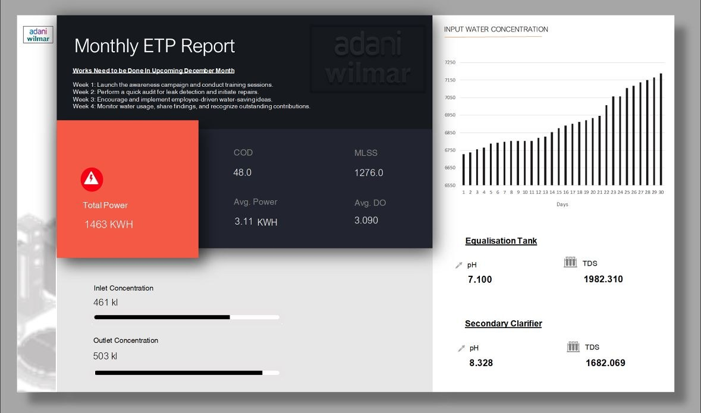
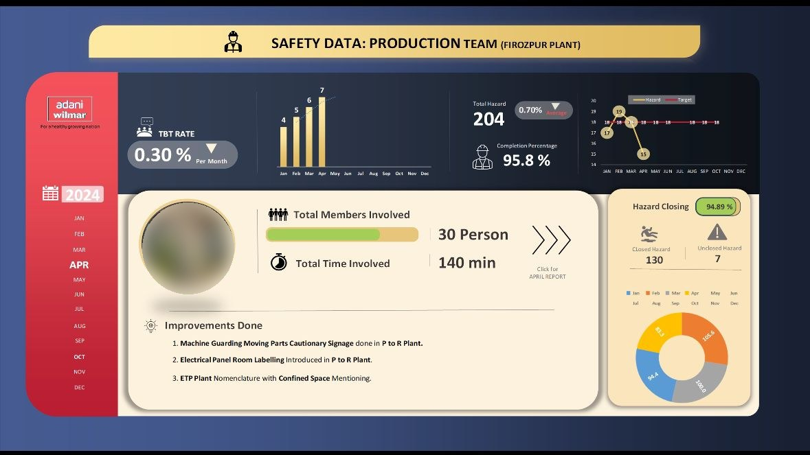

# Industrial Analytics Dashboards — Adani Wilmar, Firozpur Plant

Dashboards I built as Process Engineer at **Adani Wilmar (Firozpur, Punjab)** to track packaging-material scrap, effluent treatment (ETP) performance and production-floor safety. Each one turned raw plant data into a monthly review that the team acted on.

| # | Dashboard | Built in | Data source |
|---|-----------|----------|-------------|
| 1 | Packaging-Material Scrap Report | Excel | SAP (actual vs. booked consumption per process order) |
| 2 | Monthly ETP Report | Power BI | ETP daily log sheets |
| 3 | Safety Data — Production Team | Excel | Hazard register & toolbox-talk records |

> Screenshots are shared for portfolio purposes. SAP process-order numbers and people in photos have been blurred.

---

## 1. Packaging-Material Scrap Report

**Problem:** Packaging-material (PM) consumption on the floor did not match what was booked in SAP, and nobody could see which SKUs or material types were driving the loss.

**What I built**
- Extracted PM consumption from **SAP** and compared it with actual floor consumption for every process order in the month.
- KPI strip for average loss % and total strap, pouch film, M.bag, bag and carton consumed.
- **Top 5 loss %** by SKU and PM type, **wastage split by material type** (strap, pouch, carton, bag, M.bag) and **strapping loss % per SKU**.
- A **Root Cause Analysis** panel on the biggest contributor, strap loss:
  - Faulty press-unit equipment (universal press, cutters, jaw) and insufficient maintenance.
  - Mitigation: the press unit was replaced with two Signode strapping machines, and operators were trained on use and upkeep.

**Skills:** SAP data extraction · Pareto analysis · Root cause analysis · Excel dashboarding

---

## 2. Monthly ETP Report

**Problem:** Effluent treatment plant parameters were logged daily on paper and Excel sheets, with no single view of how the plant was performing or what to fix next.

**What I built**
- **Power BI** report covering total and average power, COD, MLSS, average DO, inlet vs. outlet volume, and pH / TDS at the equalisation tank and secondary clarifier.
- Daily **input-water concentration** trend for the month.
- A **week-by-week action plan** for the next month (awareness campaign, leak audit, water-saving ideas, monitoring).

**Result:** ETP performance tracking contributed to a **12% improvement in water recovery**.

**Skills:** Power BI · Environmental KPIs · Sustainability reporting

---

## 3. Safety Data — Production Team

**Problem:** Hazard reports and toolbox talks were tracked separately, so closure rates and monthly trends were hard to follow.

**What I built**
- Month selector with **TBT (toolbox talk) rate**, total hazards identified, completion % and hazard-vs-target trend.
- **Hazard closing %** with closed vs. open hazards and month-wise split.
- Members and time involved, plus a log of **improvements done**: machine-guarding cautionary signage, electrical panel room labelling, and ETP nomenclature with confined-space marking.

**Result:** Part of the safety analytics work that cut safety incidents by **40%**.

**Skills:** Safety KPIs · Hazard tracking · EHS · Excel dashboarding

---

**Inder Lohani** — Operational Excellence Executive @ BakeMate
[Portfolio](https://inderlohani.github.io/Portfolio/) · [LinkedIn](https://www.linkedin.com/in/inder-lohani-5104141ab)
